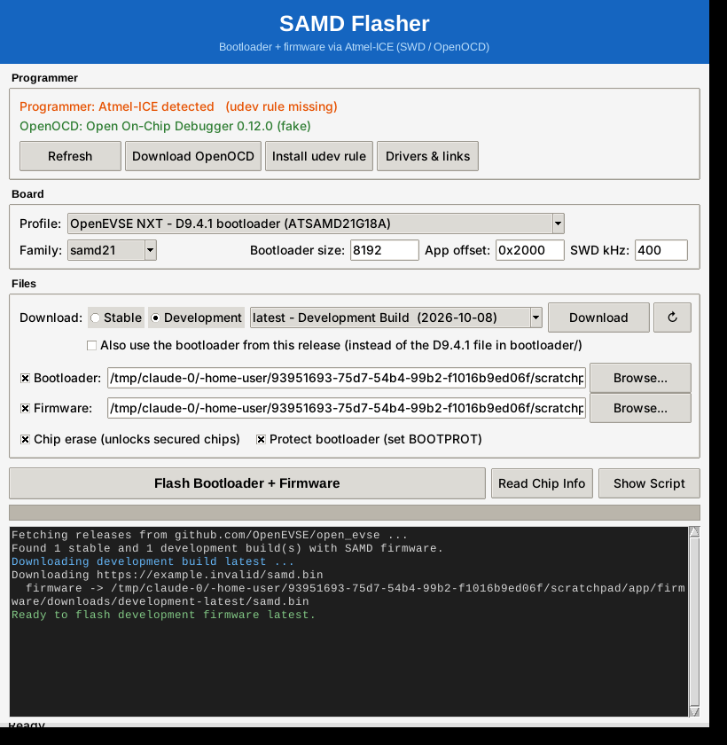

# SAMD Flasher

A simple graphical tool for loading the **D9.4.1 bootloader + OpenEVSE firmware** onto **OpenEVSE NXT (ATSAMD21G18A)** boards with an **Atmel-ICE** programmer. You don't need to use the command line. It is modelled on the OpenEVSE AVR flasher, but uses SWD and OpenOCD where that tool uses ISP and avrdude.



Profiles can also be added for other chips: SAMD09/10/11/20/21, SAMDA1, SAMR21, SAML21/22, SAMC20/21, SAMD51, SAME51/53/54.
Supported programmers: Atmel-ICE, plus EDBG / mEDBG / nEDBG (Xplained boards) and JTAGICE3.

---

## Download (no Python needed)

Get the zip for your OS from the **Releases** page: `SAMD_Flasher-windows.zip`, `SAMD_Flasher-macos.zip` (Apple Silicon) or `SAMD_Flasher-linux.zip`. Unzip it and run `SAMD_Flasher`. OpenOCD and the drivers are included. See [APP.md](APP.md) for how the app works and how releases are built.

## Running from source: requirements

- **Python 3.8 or later**: [python.org/downloads](https://www.python.org/downloads/)
  - Windows: tick **"Add Python to PATH"** during installation
  - Linux: also install Tkinter for the GUI (`sudo apt install python3-tk`)
- **Atmel-ICE** connected by USB
- **OpenOCD**: downloaded automatically on first use (xPack build, checksum-verified) into `tools/`
- Internet access the first time (for OpenOCD) and for the optional GitHub release download

## Folder structure

```
samd_flasher/
├── samd_flasher.py     # the app (GUI, or CLI with --cli)
├── run.bat / run.sh    # launchers
├── profiles.json       # board profile (OpenEVSE NXT / D9.4.1)
├── bootloader/         # put your bootloader file here (e.g. D9.4.1 .bin/.hex)
├── firmware/           # firmware; downloads go to firmware/downloads/<channel>-<tag>/
├── drivers/            # udev rule (Linux) + driver/software links
├── tools/              # OpenOCD is downloaded here automatically
└── build.bat / build.sh / samd_flasher.spec   # build a standalone .exe/zip
```

## Drivers

| OS | Driver |
|----|--------|
| Windows | None needed: the Atmel-ICE is a USB HID device. If Device Manager shows a warning, install [Microchip Studio](https://www.microchip.com/en-us/tools-resources/develop/microchip-studio), which ships Microchip's USB drivers. |
| Linux | Install the udev rule: click **Install udev rule**, or run `sudo cp drivers/99-atmel-ice.rules /etc/udev/rules.d/ && sudo udevadm control --reload-rules`, then replug. |
| macOS | None needed. |

More links are in [drivers/README.md](drivers/README.md) and behind the **Drivers & links** button.

## Wiring

Use the Atmel-ICE **SAM** port (not AVR) and the 10-pin Cortex debug cable. Connect it to the board's SWD header:

| Atmel-ICE | Board |
|-----------|-------|
| VTref | 3.3 V (required: the ICE senses target voltage) |
| GND | GND |
| SWDIO | SWDIO (PA31) |
| SWCLK | SWCLK (PA30) |
| nRESET | RESET |

**Power the board separately.** The Atmel-ICE does not supply power.

## Flashing an OpenEVSE NXT (ATSAMD21G18A)

1. Copy the **D9.4.1 bootloader** file into `bootloader/`.
2. Start the app: double-click **run.bat** on Windows, or run `bash run.sh` on Linux or macOS. The single profile is already set up for this board: SAMD21, 8 KB bootloader, firmware at `0x2000`.
3. Under **Files > Download**, choose **Stable** or **Development**:
   - **Stable**: numbered releases from [OpenEVSE/open_evse releases](https://github.com/OpenEVSE/open_evse/releases), e.g. `9.0.0`. The newest is selected; older ones are in the dropdown.
   - **Development**: the rolling `latest` "Development Build" pre-release, rebuilt from the development branch.

   Click **Download**. The app fetches that release's `samd.bin` into `firmware/downloads/<channel>-<tag>/` and fills in the Firmware box. Releases without SAMD firmware (older AVR-only ones) are not listed. Click the refresh button (↻) to reload the list.
4. By default the D9.4.1 bootloader in `bootloader/` is used. Tick **Also use the bootloader from this release** to flash the release's `bootloader-OpenEVSE_NXT-*.bin` instead.
5. Click **Read Chip Info** to test the connection. It should report a SAMD21G18A with 256 KB flash.
6. Click **Flash Bootloader + Firmware**.

| Step | What happens |
|------|--------------|
| Chip erase | Erases all flash and unlocks a secured chip |
| Clear BOOTPROT | Removes bootloader write protection, then resets |
| Write + verify bootloader | Writes the bootloader at `0x00000000` |
| Write + verify firmware | Writes `samd.bin` at `0x2000` |
| Set BOOTPROT | Write-protects the 8 KB bootloader region |
| Reset and run | Starts the board |

To **update only the firmware** and keep the bootloader, untick *Bootloader* and *Chip erase*.
To flash **only the bootloader**, untick *Firmware*.

You can also flash any local file with **Browse...**. A `.bin` is written at `0x2000`; a `.hex`/`.elf` goes to its own addresses. Only use `samd.bin`, not `samd.uf2`: the `.uf2` is for drag-and-drop updates through the bootloader's USB drive.

## Board profile (`profiles.json`)

```json
{
  "name": "OpenEVSE NXT - D9.4.1 bootloader (ATSAMD21G18A)",
  "family": "samd21",
  "bootloader_size": 8192,
  "app_offset": "0x2000",
  "bootloader": "",
  "firmware": "",
  "release_repo": "OpenEVSE/open_evse",
  "firmware_asset": "^samd\\.bin$",
  "bootloader_asset": "^bootloader-OpenEVSE_NXT.*\\.bin$"
}
```

Set `bootloader` to a path to pin a specific file. Leave it empty to use the first `.bin/.hex/.elf` in `bootloader/`.
GitHub allows 60 unauthenticated API requests per hour. If the release list fails to load, wait and press ↻, or download `samd.bin` from the releases page yourself and use **Browse...**.

## Command-line mode

```bash
python samd_flasher.py --list-releases                       # stable + development builds
python samd_flasher.py --channel stable                       # newest stable firmware + D9.4.1 bootloader
python samd_flasher.py --channel development                  # development build
python samd_flasher.py --channel stable --release 9.0.0       # a specific stable release
python samd_flasher.py --channel stable --release-bootloader  # also use the release's bootloader
python samd_flasher.py --bootloader bootloader/bl.bin --firmware firmware/app.bin
python samd_flasher.py --channel stable --bootloader none --no-erase   # update firmware only, keep bootloader
python samd_flasher.py --info              # read chip info
python samd_flasher.py --channel stable --dry-run           # show the OpenOCD script without flashing
python samd_flasher.py --download-openocd
python samd_flasher.py --links
```

## Building a standalone package

`build.bat` (Windows) or `bash build.sh` (macOS/Linux) builds a self-contained zip with PyInstaller. The zip holds the executable, OpenOCD, drivers, profiles and whatever is in `bootloader/` and `firmware/`, so the person running it doesn't need Python.

## Troubleshooting

The log shows a hint when a flash fails. The most common causes:

- **"unable to find a matching CMSIS-DAP device"**: the programmer is not plugged in, or the udev rule is missing (Linux).
- **"Error connecting DP"**: the cable is in the AVR port instead of SAM, the board is unpowered, VTref is not connected, or the wiring is wrong.
- **Verify failed**: lower *SWD kHz* to 100 and use a shorter cable.
- **Board doesn't start after flashing**: the firmware is not built for the bootloader's app offset, or the bootloader is for a different chip variant.
